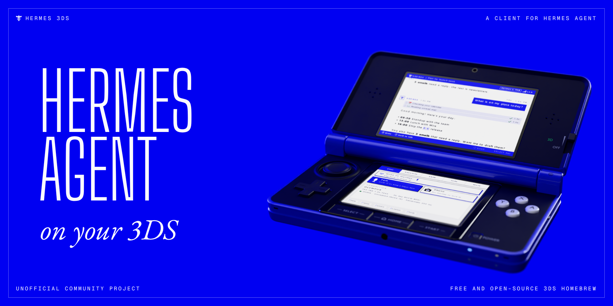
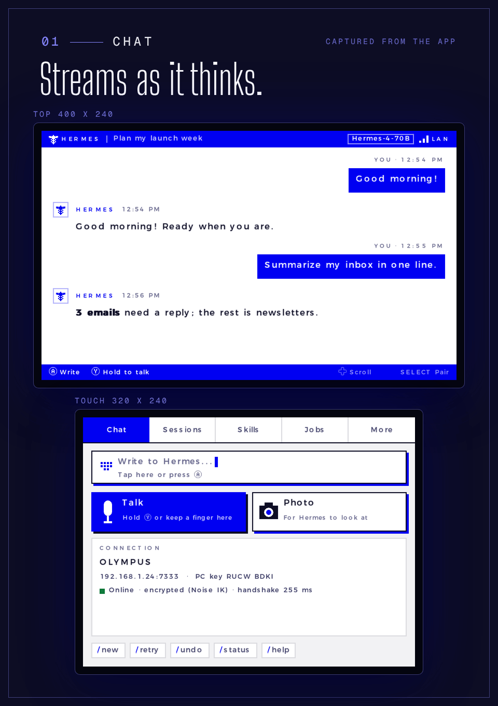
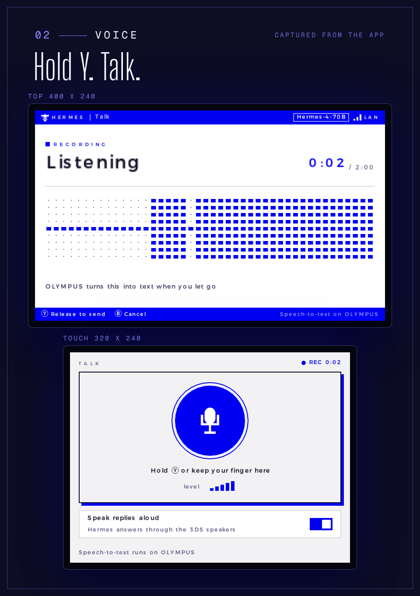
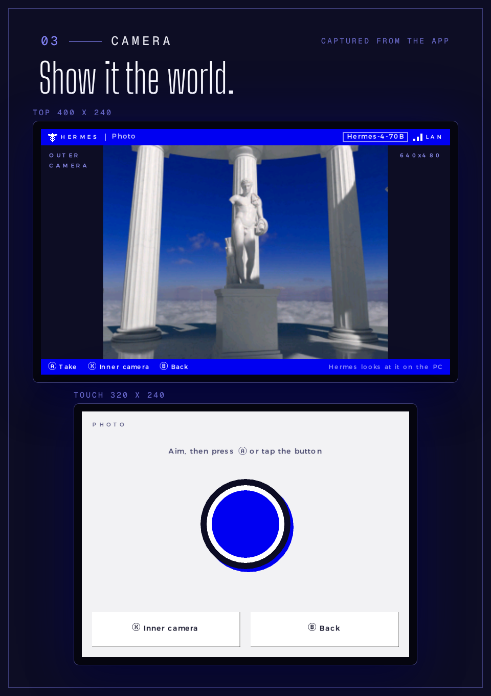
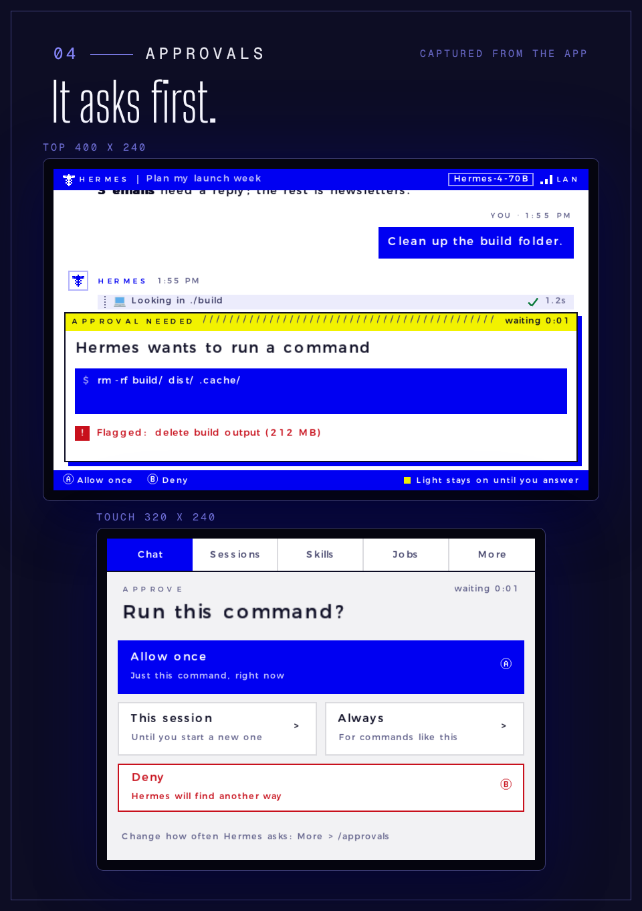
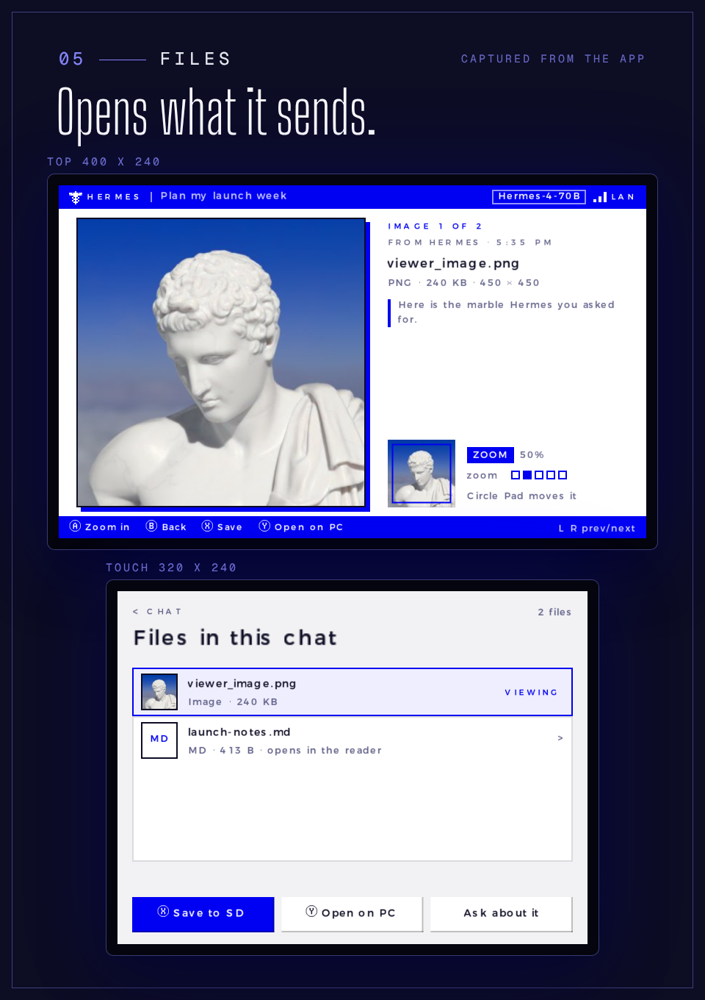
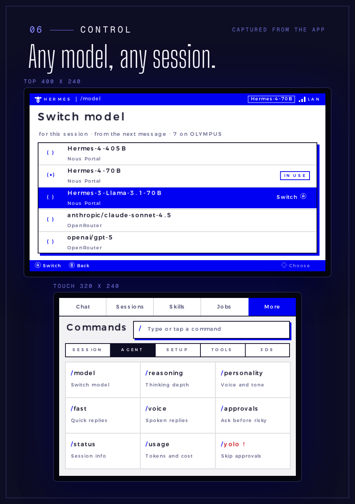
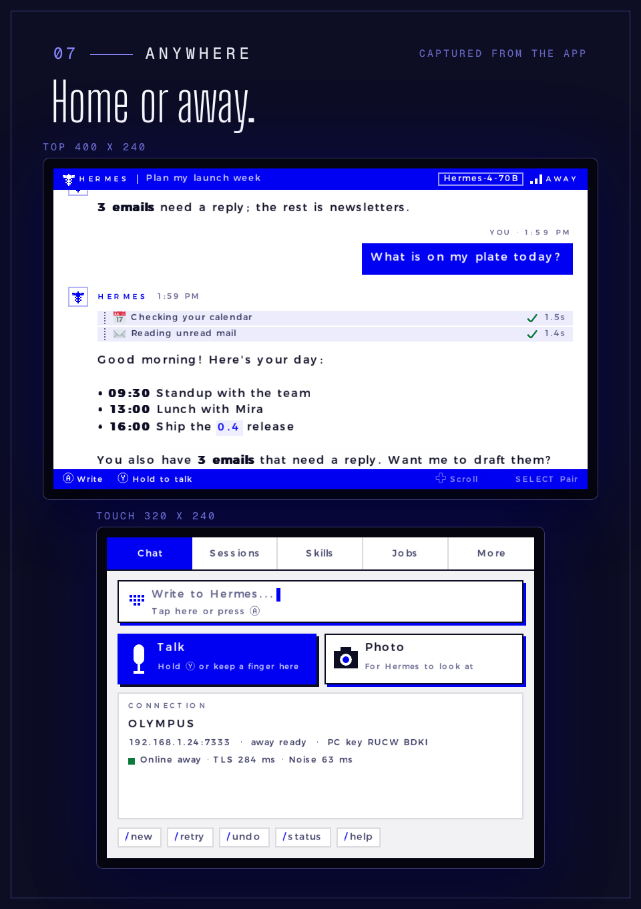
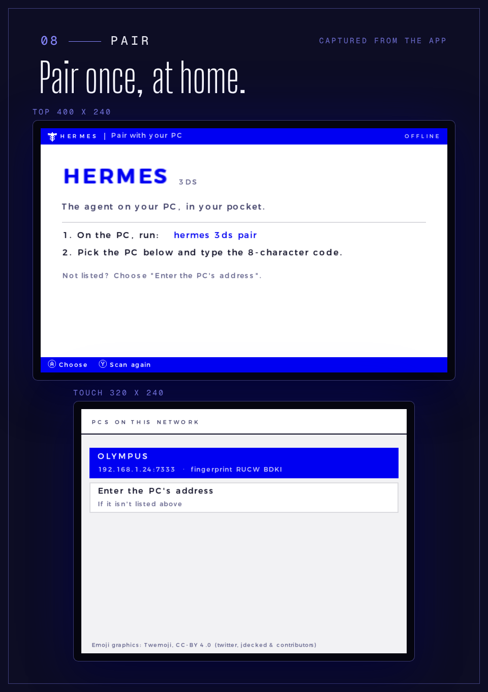
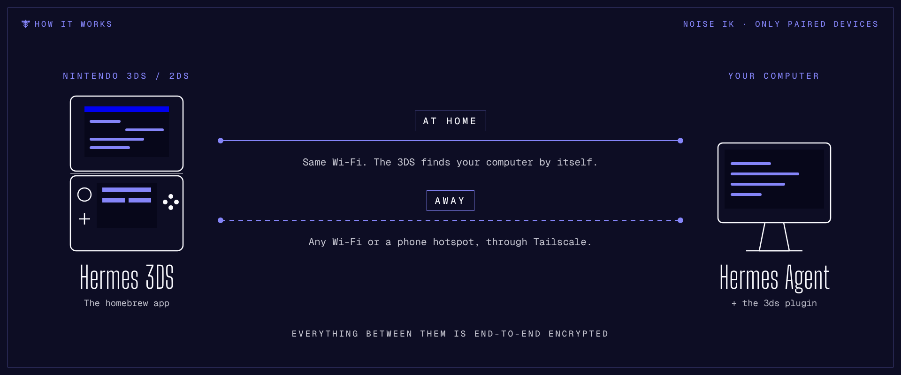

<p align="center">
  
</p>

# Hermes 3DS

<p>
  <a href="https://github.com/rndaom/Hermes3DS/releases/latest"></a>
  <a href="LICENSE"></a>
  
</p>

Talk to your [Hermes Agent](https://github.com/NousResearch/hermes-agent) from a Nintendo 3DS.

Hermes 3DS is a homebrew app for the 3DS plus a small plugin for the Hermes gateway on your computer. Replies
stream onto the top screen as they're written; you answer with the keyboard, your voice or the camera.

> **Unofficial community project.** Not affiliated with, endorsed by or sponsored by Nous Research or Nintendo.

<p align="center">
  
  
</p>
<p align="center">
  
  
</p>

<details>
<summary><b>More screens:</b> files, models and sessions, away from home, pairing</summary>
<br>
<p align="center">
  
  
</p>
<p align="center">
  
  
</p>
</details>

These are real screens from the app, captured in an emulator with a scripted test server standing in for Hermes.

## What it does

- **Chat:** streaming replies with formatting, colour emoji, tables and code; tool activity as it runs; Stop.
- **Approvals and questions:** when Hermes asks to run a command or asks you something, the 3DS shows it (and
  blinks the notification LED) so you can allow, deny or answer.
- **Sessions, skills, jobs, models:** browse and resume sessions, see skills and scheduled jobs, switch model,
  run slash commands from a grid.
- **Files:** pictures, documents (text, Markdown, code, PDF, Office), and audio sent by Hermes open in a
  viewer, a reader or a player. Save to SD, or open the original on your computer.
- **Voice and camera:** hold Y to send a voice message (Hermes transcribes it), take a photo for Hermes to look
  at, and have replies read aloud.
- **At home and away:** finds your computer on the Wi-Fi by itself; with Tailscale it also works over the
  internet (a phone hotspot, a friend's Wi-Fi).
- **Encrypted:** everything between the 3DS and your computer is end-to-end encrypted (Noise IK), and only a
  3DS you paired can connect.

## How it works

<p align="center">
  
</p>

The plugin makes the 3DS one more chat platform for your Hermes gateway: the same agent, with the same tools
and skills. At home the 3DS finds your computer on the Wi-Fi by itself; anywhere else it can connect through your
Tailscale Funnel ([away from home](#away-from-home)). Either way the connection is end-to-end encrypted, and only a 3DS you paired can connect.

## What you need

- A **Nintendo 3DS / 2DS** (Old or New) with custom firmware (Luma3DS) and the Homebrew Launcher. It was built
  and tested on an Old 3DS.
- For sounds, audio and spoken replies: the DSP firmware dump at `sdmc:/3ds/dspfirm.cdc` (Rosalina menu:
  L + Down + Select → Miscellaneous options → Dump DSP firmware). Everything else works without it.
- A computer running **Hermes Agent 0.22.5 or newer** with its gateway running (`hermes gateway run`, or `hermes gateway install` to run it as a service).
- Wi-Fi the 3DS can join: **WPA2** (not WPA3-only), 2.4 GHz, no sign-in page. A phone hotspot works well.
- Optional: `ffmpeg` on the computer for audio and voice replies; Tailscale for use away from home.

## Install

### 1. The plugin (on the computer that runs Hermes)

```bash
hermes plugins install rndaom/Hermes3DS#plugin
hermes plugins enable 3ds-platform
```

Turn the platform on in Hermes' `config.yaml` (and turn on streaming, which Hermes leaves off by default):

```yaml
platforms:
  3ds:
    enabled: true
streaming:
  enabled: true
```

Then restart the gateway: `hermes gateway restart`.

The plugin listens on **TCP 7333** (the 3DS connects here) and **UDP 7334** (so the 3DS can find the
computer). If your firewall blocks them, allow both from your home network.

### 2. The app (on the 3DS)

Download `hermes3ds.3dsx` from the [latest release](https://github.com/rndaom/Hermes3DS/releases/latest),
copy it to `sdmc:/3ds/` on the SD card, and start it from the Homebrew Launcher.

Or install `hermes3ds.cia` with [FBI](https://github.com/nh-server/FBI-NH/releases) to get a HOME Menu icon.

### 3. Pair them (once, at home)

1. On the computer: `hermes 3ds pair`. It prints a code (valid for 5 minutes, letters A-Z and digits 2-7) and
   the computer's fingerprint.
2. On the 3DS, open Hermes. It looks for Hermes on your network; choose your computer (or **Enter the PC's
   address** if it isn't listed) and type the code.
3. The 3DS then shows the computer's fingerprint: check that it matches the one `hermes 3ds pair` printed, then
   press A.

The 3DS and the computer must be on the same network for pairing. After that, the 3DS reconnects by itself.
To remove a 3DS: `hermes 3ds devices`, then `hermes 3ds unpair <name>`.

## Using it

| Button | Does |
|---|---|
| A | Write a message / the main action on screen |
| B | Back; during a reply, Stop |
| Y (hold) | Record a voice message; release to send, B to cancel |
| Y (tap) | Play or pause the latest audio |
| X | Files in this chat |
| L / R | Switch tabs: Chat, Sessions, Skills, Jobs, More |
| Circle Pad / D-pad | Scroll |
| SELECT | Look for the computer again |
| START | Quit |

The touch screen works too. Settings for sounds and spoken replies are on the **More** tab.

Spoken replies and voice messages use Hermes' own speech settings: turn on speech-to-text with `hermes tools`
(Local Whisper works offline).

Spoken replies can start while Hermes is still writing: set up Piper (`hermes tools` → Voice & TTS → Piper, which
downloads a voice on first use), then set `tts.piper.voice` and `tts.streaming.provider: piper-stream` in
`~/.hermes/config.yaml`. The plugin registers that provider and speaks each sentence while the model is still
writing it, sending the 3DS the speech in parts of a few seconds that it plays one after another, without adding
voice messages to the chat (`speech_groups: false` under `platforms.3ds` sends the whole reply as one voice
message instead, when the model is done). Without it Hermes speaks the whole reply with its normal TTS provider
afterwards. **VOICE** in the top bar shows that Spoken replies is on.

## Away from home

Off unless you turn it on. Install Tailscale on the computer and sign in, run `hermes 3ds away on` (it sets up a
Tailscale Funnel), restart the gateway, and the 3DS learns the address the next time it connects at home.
Details: [docs/away-from-home.md](docs/away-from-home.md).

## Troubleshooting

- **The 3DS can't find the computer / "PC not reachable":** first check the gateway is running with the
  plugin on: `hermes plugins list` shows `3ds-platform` enabled, `hermes gateway status` says running, and
  `~/.hermes/logs/gateway.log` has the line `3DS: listening on 0.0.0.0:7333 (secure)`. Both devices must be on
  the same network (some routers put IoT or guest Wi-Fi on its own network). Use **Enter the PC's address**
  with the computer's local IP, and check the firewall allows TCP 7333 and UDP 7334 (Windows: the network
  profile must allow Hermes' Python; Linux: for example `sudo ufw allow 7333/tcp` and `7334/udp`). Hermes in
  Docker needs host networking for discovery.
- **"The network blocks the PC and 3DS from connecting":** the router keeps Wi-Fi clients apart (AP or client
  isolation, common on guest networks). Turn that off, or use another network.
- **The gateway log says the 3DS listener port is in use:** another gateway or Hermes profile already runs the
  plugin. Stop it, or set `port:` under `platforms.3ds` (the 3DS finds the new port by discovery).
- **"Pairing didn't work":** the code is single-use and lasts 5 minutes; run `hermes 3ds pair` again. Pairing
  data lives in the Hermes profile's `plugin-data/3ds` folder, so pair with the same profile the gateway runs.
- **"... doesn't know this 3DS any more":** it was unpaired, or the plugin's data folder was reset. Press SELECT
  and pair again.
- **It worked, then never connects again ("Connection lost" forever):** the computer's key changed, for
  example after Hermes' data folder was reset or moved to a new computer. Pair again.
- **A message shows "NOT SENT":** the connection dropped before the computer got it. Send it again once the
  status bar shows the link.
- **Replies arrive all at once instead of streaming:** turn on `streaming.enabled` (see Install).
- **No sound:** dump the DSP firmware (see *What you need*).
- **Audio files arrive as plain files, no spoken replies:** install `ffmpeg` on the computer; for spoken
  replies, text-to-speech must work in Hermes too.
- **Voice messages arrive but nothing is heard:** speech-to-text isn't set up in Hermes (`hermes tools`).
- **Away from home doesn't connect:** see the troubleshooting table in
  [docs/away-from-home.md](docs/away-from-home.md).
- The app writes a log to `sdmc:/3ds/hermes/log.txt`; the gateway logs to `~/.hermes/logs/`.

## What the plugin does on your computer

- Listens on TCP 7333 and answers discovery on UDP 7334 on your network; may connect back to a 3DS's LAN address
  when the 3DS asks.
- Away mode is off by default. Once you turn it on (`hermes 3ds away on`), it asks Tailscale to publish a Funnel
  to a loopback listener on port 7339. `hermes 3ds away off` removes it; `away: off` in the config never
  touches Tailscale.
- Runs `tailscale`, `ffmpeg` (audio for the 3DS) and your desktop's file opener (for **Open on PC**).
- Downloads images linked in replies to shrink them for the 3DS.
- Keeps its key and the paired consoles in Hermes' plugin data folder. No telemetry.

The full list is in [plugin/README.md](plugin/README.md#what-it-does-on-your-computer).

## Security

- The 3DS and the plugin use the Noise IK handshake (X25519, ChaCha20-Poly1305, BLAKE2b). Each side has a long-term
  key; the computer only accepts 3DS keys it paired, and the 3DS only talks to the computer it paired with.
- Pairing only works from your local network. Over the internet (Tailscale Funnel) only already-paired devices
  get in, and the connection is encrypted end to end on top of TLS.
- A paired 3DS has the same power over your agent as you do in any other Hermes chat, including approving
  commands. Keep it as safe as your phone; if it's lost, `hermes 3ds unpair <name>` it. Its key is stored on the SD
  card (`sdmc:/3ds/hermes/device_key`).
- Pairing compares an 8-character fingerprint; check it.

Report security problems privately: see [SECURITY.md](SECURITY.md).

## Building from source

**App:** install [devkitPro](https://devkitpro.org/wiki/Getting_Started) with the `3ds-dev` group and the
portlibs `3ds-mbedtls 3ds-libjpeg-turbo 3ds-libpng 3ds-zlib 3ds-jansson`, then run `app/build.sh` (or `make` in
`app/`). `app/build.sh cia` makes the installable `hermes3ds.cia` (needs `makerom` and `bannertool` on PATH;
the icon and HOME Menu banner are in `app/meta/`, made by `tools/build_meta.py`). Host tests:
`app/test/run_tests.sh` (needs a C compiler and Python; ffmpeg for the audio tests).

**Plugin tests:** `pip install -r plugin/requirements-dev.txt`, then `python -m pytest` in `plugin/`.

**Tools:** `tools/fake3ds.py` (a 3DS client for the terminal), `tools/mock_pc.py` (a scripted server for testing
the app without a model), `tools/hermes_integration.py` (adapter checks inside a Hermes environment).

The wire protocol is documented in [docs/protocol.md](docs/protocol.md).

## Licence and credits

MIT, see [LICENSE](LICENSE). Third-party components and their licences: [THIRD-PARTY-NOTICES.md](THIRD-PARTY-NOTICES.md).

Emoji graphics are from [Twemoji](https://github.com/jdecked/twemoji) (v17.0.3), copyright Twitter, Inc. and
other contributors, and jdecked and other contributors, licensed under
[CC-BY 4.0](https://creativecommons.org/licenses/by/4.0/). They are scaled down and repacked for the 3DS
(`tools/build_emoji.py` → `app/romfs/emoji.bin`). The app shows this credit on its connect screen and ships it
as `romfs:/emoji-credits.txt`.
